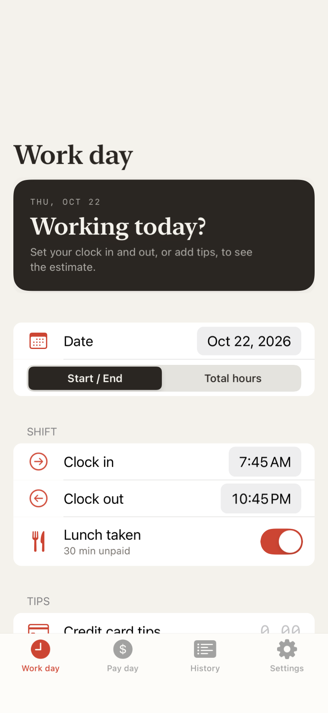
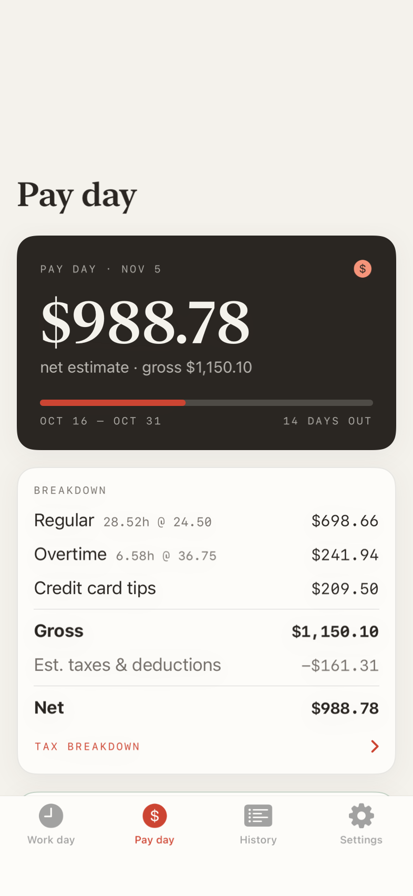
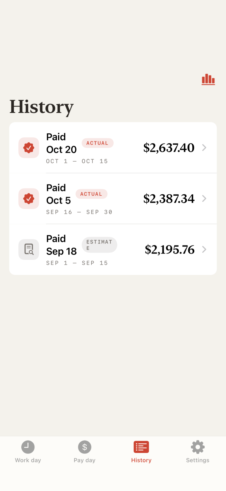
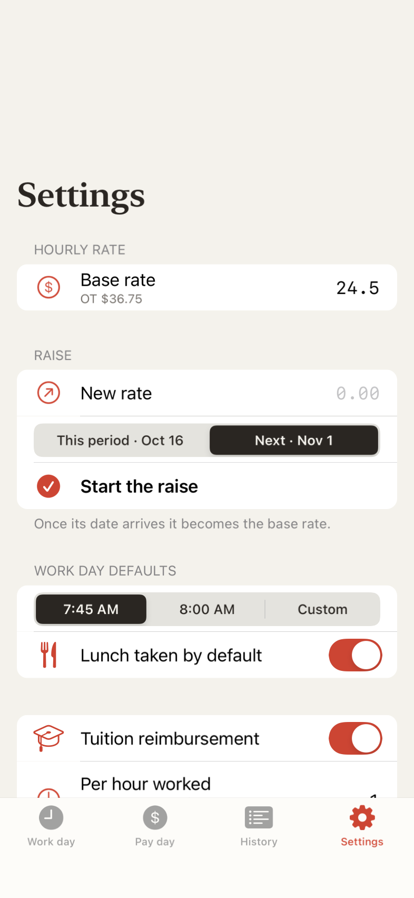
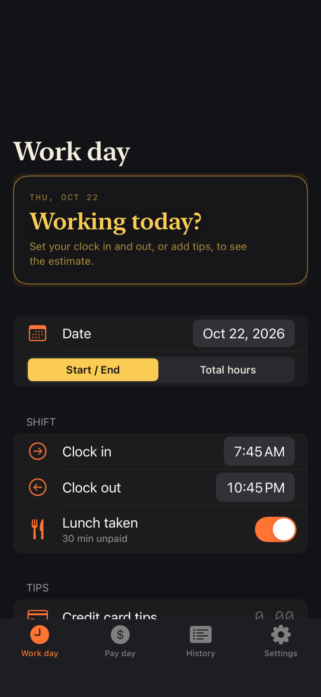
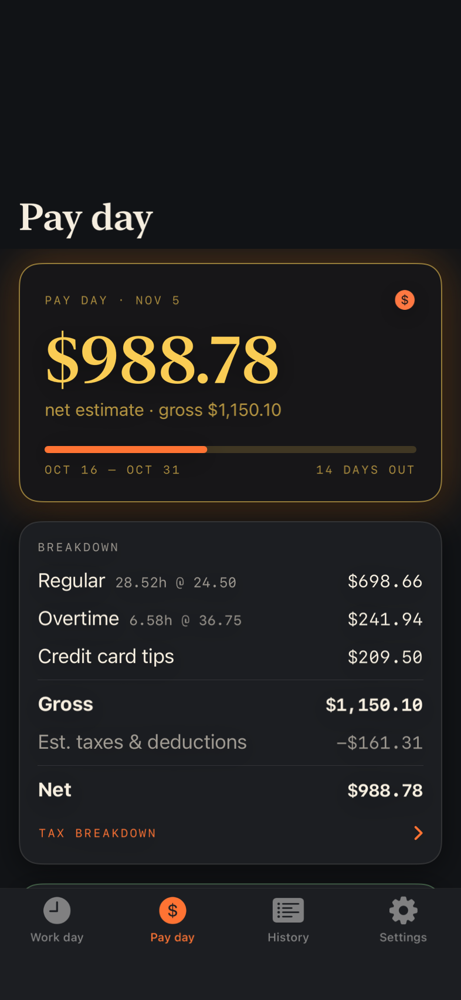
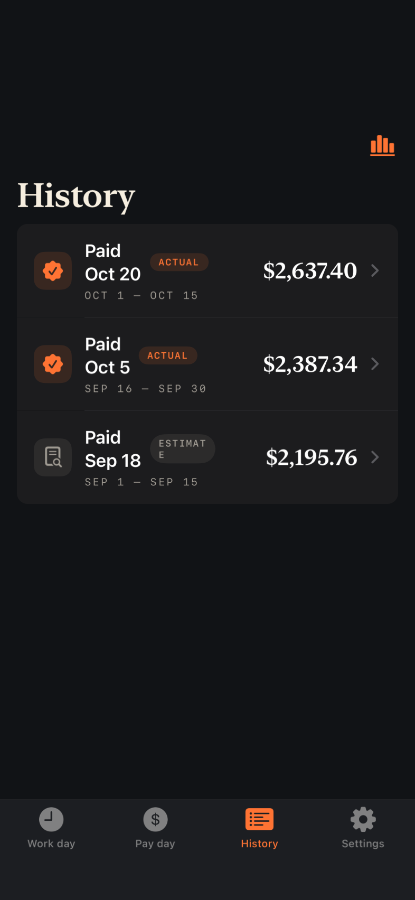
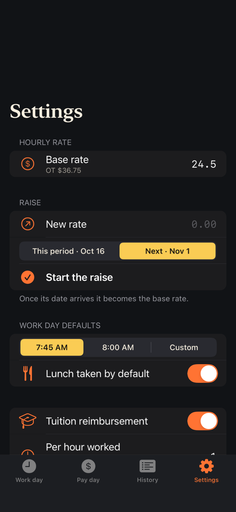

<p align="center">
  
</p>

<h1 align="center">Prepay</h1>

<p align="center"><em>Know the check before it lands.</em></p>

A pay-period tracker for an hourly, tipped job in Washington State. Log each day
you work (clock in, clock out, lunch, tips, travel) and it estimates what the
next check should come to. When the real stub arrives you enter it, and History
keeps both side by side and flags anything payroll missed.

| | Work day | Pay day | History | Settings |
| --- | --- | --- | --- | --- |
| **Classic** |  |  |  |  |
| **Firehouse** |  |  |  |  |

<sub>Screenshots use made-up sample data.</sub>

There are two apps over one database:

- **iPhone**: a SwiftUI app in [`ios/`](ios/), installed with
  [xtool](https://github.com/xtool-org/xtool). The screenshots above.
- **Web**: a Vite + React site in [`src/`](src/), live at
  <https://lustrous-puffpuff-8d6741.netlify.app/>.

Both sign in with Apple or Google through Supabase and read and write the same
rows, so a day logged on the phone shows up on the web and the other way round.

## Screens

- **Work day**: record a day. Clock-in starts at your default start time and
  clock-out at now, but the card at the top asks *Working today?* until you
  change something; only then does it show the hours and pay for the day. Then
  lunch, credit-card tips, cash tips, POV miles, and Local / Travel / Away.
- **Pay day**: the estimate for the coming check: regular and overtime pay,
  tips, per-diem, gross, a tax breakdown and net, how far through the period you
  are, and the days logged so far. If tuition was expected on a check that has
  just paid, it asks whether it came through.
- **History**: past pay periods, real stubs marked `ACTUAL` and logged-only
  periods `ESTIMATE`. **Add the … check** creates a stub prefilled from your
  log to correct off the real one. **Stats** (top right) has the fun numbers:
  best and worst days, longest streaks, best week, busiest weekday and more.
- **Settings**: base rate and raise, start-time and lunch defaults, tuition,
  mileage rate, sick hours, the theme (iPhone), backup (web), and sign out.

### Themes (iPhone)

Settings → Theme switches between **Classic** (warm paper, ink and brick red,
like the site) and **Firehouse** (black and gold, after the app icon). The
choice is saved on the phone.

## How the estimate is worked out

The math lives in [`src/lib/pay.ts`](src/lib/pay.ts), with tests beside it, and
is ported line for line to
[`ios/PrepayCore`](ios/PrepayCore/Sources/PrepayCore/Pay.swift). Change one and
change the other.

Wages are `regular hours x rate` plus `overtime hours x rate x 1.5`, overtime
counting past 40 hours in a Saturday–Friday week.

| Amount | In gross? | In the WA premiums? | Notes |
| --- | --- | --- | --- |
| Regular and overtime pay | yes | yes | |
| Credit-card tips | yes | **no** | taxed federally, outside FLI/Cares/MLI |
| Per-diem | yes | yes | paid as the "spot bonus" on the stub |
| Sick-hour cash-out | yes | yes | straight time, no Workers Comp; entered on a stub as sick hours paid |
| Tuition, POV mileage | **no** | **no** | reimbursements, added after tax |

Deduction rates, read off the stubs:

| Line | Rate | Levied on |
| --- | --- | --- |
| Federal income tax | 2026 IRS semi-monthly brackets: 10% over $670.83, 12% over $1,187.50, 22% over $2,770.83, 24% over $5,075 | gross |
| Social Security | 6.2% | gross |
| Medicare | 1.45% | gross |
| Washington FLI | 0.5433% | wages + per-diem |
| Washington Cares | 0.58% | wages + per-diem |
| Washington MLI | 0.2643% | wages + per-diem |
| WA Workers Comp | $0.3519 / hour | hours actually worked |

### Per-diem

A fixed **$51** for a travel day and **$75** for a full day away. It shows up on
the stub as the spot bonus, on the check for the period the days fall in, and is
taxed like wages. History flags a stub whose bonus doesn't match the travel days
you logged.

### Raises

Rates are kept as a dated history. A raise is set to start on this pay period
or the next. Until then it sits under **Raise**. Once its start date arrives it
simply is the base rate: Base rate shows the new figure and the Raise field is
empty again. Periods before the raise keep the old rate.

### Sick hours

Settings keeps a running balance. Type the balance off your latest stub once;
from then on each check adds `floor(hours worked) / 40` on its pay date (stub
hours where there is a stub, logged hours otherwise), and a cash-out comes off
the balance as soon as you schedule it.

### Tuition reimbursement

$1.00 per hour worked by default, a period behind: a payout on a check settles
the hours through the period before it. HR enters it by hand, so the app
**expects it every other check**, counting from the last check it landed on.
When an expected check pays, Pay day asks **did it come through?**

- **Yes**: record the amount. The every-other count restarts from this check.
- **No**: it moves to the very next check, and the amount keeps growing.

If it lands on a check where it wasn't expected, mark it in History. That
restarts the count from there too. An expected check you never answer is
treated as missed.

### Tips, and checking them

Enter your own share of the pooled credit-card tips. When a period has both a
stub and logged days, History compares them and flags any gap in tips, hours
or per-diem. A missing shift's tips on a check show up this way.

## Data and privacy

Nothing personal ships in the page or the app. Your pay data lives in Supabase
(project `prepay`) in six tables: `settings`, `rates`, `days`, `stubs`,
`sick_cashouts` and `tuition_events`. Every table has row-level security, so a
signed-in user can only see and change their own rows. The schema is in
[`supabase/migrations`](supabase/migrations/).

The Supabase URL and publishable key in `src/config.ts` and
`ios/Sources/Prepay/Config.swift` are meant to be public. They name the
project; row-level security is what protects the data.

**Moving over from the old version:** sign in on the browser you used before,
open Settings, and use **Move it into my account**. It only appears if that
browser still has the old data. A text backup from the old **Export** button
also works through **Import**.

## Running the iPhone app

Install xtool ([Linux](https://xtool.sh/documentation/xtooldocs/installation-linux),
[macOS](https://xtool.sh/documentation/xtooldocs/installation-macos)) and run
`xtool setup` once to sign in with your Apple ID. Then plug in the iPhone, tap
**Trust** on it, and:

```
cd ios
xtool dev
```

The first time, turn on **Settings → Privacy & Security → Developer Mode** on
the phone, and with a free Apple ID trust yourself under **Settings → General →
VPN & Device Management**. A free Apple ID's install lasts 7 days before it
needs running again; a paid developer account lasts a year.

The pay math has its own tests: `cd ios/PrepayCore && swift test`.

## Running the web app

```
npm install
npm run dev      # http://localhost:5173
npm test         # pay math tests
npm run build    # typecheck + production build into dist/
```

Netlify runs the tests and the build on every deploy (see `netlify.toml`).

## Updating the screenshots

Run the **Screenshots** workflow from the Actions tab. It renders the iPhone
screens in the simulator from the sample data in
[`ios/Tests/PrepayScreenshots`](ios/Tests/PrepayScreenshots/Screenshots.swift)
and commits them to `docs/screenshots/` on the branch it ran on.

## Project layout

| Path | What's there |
| --- | --- |
| `ios/Sources/Prepay` | the iPhone app's screens, theme and Supabase sync |
| `ios/PrepayCore` | the pay math, a line-for-line port of `src/lib`, with tests |
| `ios/Tests/PrepayScreenshots` | renders the README screenshots |
| `src/` | the web app; `src/lib/pay.ts` is the pay math |
| `supabase/migrations` | the database schema and row-level security |
| `scripts/apple-client-secret.mjs` | makes the Sign in with Apple secret (below) |
| `.github/workflows` | CI for the web app and the iPhone app, and the screenshots |

## One-time setup for sign-in

Sign-in needs the providers switched on in Supabase. Until then the buttons
return an error.

1. **Supabase → Authentication → URL Configuration**
   - Site URL: `https://lustrous-puffpuff-8d6741.netlify.app`
   - Redirect URLs: `https://lustrous-puffpuff-8d6741.netlify.app/**`,
     `http://localhost:5173/**` and `prepay://auth-callback` (the iPhone app)
2. **Google**: in Google Cloud Console create an OAuth client of type *Web
   application* with authorized redirect URI
   `https://akdcwtpfxxhtasqtxqdf.supabase.co/auth/v1/callback`. Paste its client
   ID and secret into **Supabase → Authentication → Providers → Google**.
3. **Apple**: needs a paid Apple Developer account. Create a Services ID with
   return URL `https://akdcwtpfxxhtasqtxqdf.supabase.co/auth/v1/callback`, and a
   Sign in with Apple key. Supabase wants a JWT signed with that key, not the
   `.p8` file itself; make one with

   ```
   node scripts/apple-client-secret.mjs ~/path/AuthKey_XXXXXXXXXX.p8 <TEAM_ID> <SERVICES_ID>
   ```

   and paste the output, with the Services ID under Client IDs, into
   **Supabase → Authentication → Providers → Apple**. Apple makes the JWT
   expire after 6 months: run the script again and paste the new one before
   then, or Apple sign-in stops working. Keep the `.p8` out of the repo.

The iPhone app signs in through the same web flow in a system sheet, so this
one setup covers both apps. It needs no Sign in with Apple entitlement, which
xtool can't provision.
